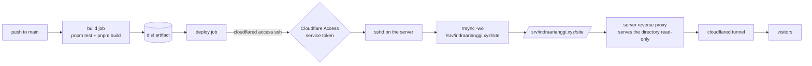

# Deployment

The site is built on a GitHub-hosted runner and pushed to the home server over a Cloudflare Tunnel. The server never accepts inbound connections, and no self-hosted runner is used, so the setup stays safe while `indraarianggi/indraarianggi.xyz` is a public repository.



| File | Role |
|---|---|
| `.github/workflows/deploy.yml` | Build, then rsync the build to the server through the tunnel, then verify the live site |
| `deploy/ssh/authorized_keys.example` | Restricted key entry for the deploy user |

The server itself (OS, Docker, the shared reverse proxy, and the tunnel) is provisioned outside this repository and hosts other projects as well. This document covers only what this site needs from it: the contract below, the GitHub configuration, and how deploys behave.

Paths used throughout: site directory `/srv/indraarianggi.xyz/site`, deploy user `deploy`, deploy hostname `ssh.indraarianggi.xyz`, public origin `https://indraarianggi.xyz`.

## 1. Server contract

The workflow assumes the server provides the following. Each item is checked by the first deploy, which fails closed if anything is missing.

### Tunnel routes

The Cloudflare Tunnel must route both hostnames, with the SSH rule listed before any wildcard rule:

```yaml
ingress:
  - hostname: ssh.indraarianggi.xyz
    service: ssh://localhost:22
  - hostname: indraarianggi.xyz
    service: http://localhost:8080      # the server's reverse proxy
  # ...other hostnames, then the required catch-all
  - service: http_status:404
```

`www.indraarianggi.xyz` must also reach the reverse proxy, which redirects it to the apex.

### Cloudflare Access on the deploy hostname

The deploy hostname must not accept anonymous SSH, so it sits behind an Access application that only a service token can satisfy.

1. Zero Trust, Access controls, Service credentials, Service Tokens: create a token for this repository, for example `github-indraarianggi.xyz`. The Client Secret is shown only once.
2. Zero Trust, Access controls, Applications: create a self-hosted application for `ssh.indraarianggi.xyz`.
3. Give it a policy with Action `Service Auth` and Include `Service Token` equal to the token from step 1. Use `Service Auth`, not `Allow`: `Allow` sends the runner to an interactive login page and the deploy hangs.

Do not create an Access application for `indraarianggi.xyz` itself unless you want the public site gated too.

The service token authenticates the runner to Cloudflare. SSH authentication still happens on top of it, with the deploy key.

### Deploy user, directory, and key

```bash
# on the server
sudo install -d -m 0755 -o deploy -g deploy /srv/indraarianggi.xyz /srv/indraarianggi.xyz/site
command -v rrsync      # must print /usr/bin/rrsync
```

Generate the key on your workstation, so the private half never touches the server:

```bash
ssh-keygen -t ed25519 -C deploy@indraarianggi.xyz -f ~/.ssh/deploy_indraarianggi_xyz -N ''
scp ~/.ssh/deploy_indraarianggi_xyz.pub <admin>@<server>:/tmp/
```

Append the public half on the server with a forced command, so the key can only push files into the site directory. Append, never overwrite: other projects keep their own lines in the same file.

```bash
# on the server
line="command=\"/usr/bin/rrsync -wo /srv/indraarianggi.xyz/site\",no-agent-forwarding,no-port-forwarding,no-pty,no-user-rc,no-X11-forwarding $(cat /tmp/deploy_indraarianggi_xyz.pub)"
printf '%s\n' "$line" | sudo tee -a /home/deploy/.ssh/authorized_keys > /dev/null
rm /tmp/deploy_indraarianggi_xyz.pub
```

Confirm the restriction took effect from your workstation. This should fail with an rrsync error rather than printing a shell:

```bash
export TUNNEL_SERVICE_TOKEN_ID='<Client ID>' TUNNEL_SERVICE_TOKEN_SECRET='<Client Secret>'
ssh -i ~/.ssh/deploy_indraarianggi_xyz \
  -o ProxyCommand='cloudflared access ssh --hostname %h' \
  deploy@ssh.indraarianggi.xyz true
unset TUNNEL_SERVICE_TOKEN_ID TUNNEL_SERVICE_TOKEN_SECRET
```

The first connection asks you to trust the host key. Compare it with `ssh-keygen -lf /etc/ssh/ssh_host_ed25519_key.pub` on the server before answering `yes`.

Do not forward port 22 from the router. The tunnel is the only intended path in.

### Serving the directory

The reverse proxy must serve `/srv/indraarianggi.xyz/site` read-only with these behaviors, all of which the workflow's verification step depends on:

- Unknown paths return status `404` with the body of `404.html`.
- Content-hashed files under `/_astro/` are cached as immutable; everything else (HTML, feed, sitemap) revalidates after every deploy.
- `www.indraarianggi.xyz` redirects permanently to the apex.
- No reload is needed when files change.

A Caddy site block that satisfies this, for a proxy that terminates plain HTTP behind the tunnel:

```caddyfile
http://indraarianggi.xyz {
	root * /srv/indraarianggi.xyz/site
	encode zstd gzip

	# The two matchers are mutually exclusive on purpose: Caddy evaluates
	# matcher-scoped header routes before matcher-free ones, so a bare default
	# would overwrite whichever rule it happened to run after.
	@hashed path /_astro/*
	@revalidate not path /_astro/*
	header @hashed Cache-Control "public, max-age=31536000, immutable"
	header @revalidate Cache-Control "public, max-age=0, must-revalidate"

	file_server

	# Astro emits dist/404.html; keep the error status while serving that body.
	handle_errors {
		rewrite * /404.html
		file_server
	}
}

http://www.indraarianggi.xyz {
	redir https://indraarianggi.xyz{uri} permanent
}
```

## 2. GitHub configuration

Repository secrets, Settings, Secrets and variables, Actions:

| Secret | Value |
|---|---|
| `DEPLOY_SSH_KEY` | Private key from `ssh-keygen` (full OpenSSH text, including the header and footer lines) |
| `DEPLOY_KNOWN_HOSTS` | The server's pinned host key, one line (command below) |
| `CF_ACCESS_CLIENT_ID` | Access service token Client ID |
| `CF_ACCESS_CLIENT_SECRET` | Access service token Client Secret |

Take `DEPLOY_KNOWN_HOSTS` from the server itself over loopback, so the pinned key never crosses a network you would have to trust:

```bash
# on the server
ssh-keyscan -t ed25519 localhost 2>/dev/null | sed 's/^localhost/ssh.indraarianggi.xyz/'
```

Once the secrets are saved and the first deploy succeeds, delete the private key from your workstation. A lost key is replaced by generating a new pair and swapping the `authorized_keys` line.

Repository variables (optional; the workflow defaults shown apply when unset):

| Variable | Default | Purpose |
|---|---|---|
| `SITE_URL` | `https://indraarianggi.xyz` | Origin baked into canonical URLs, `sitemap-index.xml`, `robots.txt`, and the feed |
| `DEPLOY_HOST` | `ssh.indraarianggi.xyz` | Tunnel hostname routed to sshd |

Keep Cloudflare's Bot Fight Mode off for this zone. It challenges the runner's `curl` calls in the verification step, and the Free plan cannot exempt them.

## 3. Deploy

Push to `main`, or run the workflow manually from the Actions tab (or `gh workflow run deploy.yml --ref main`). The workflow:

1. Installs with `--frozen-lockfile`, runs `pnpm test`, then `pnpm build`.
2. Fails the job if `dist/` is missing expected files, if the sitemap does not use `SITE_URL`, or if the `.invalid` placeholder origin leaked into the output.
3. Uploads `dist/` as an artifact, then rsyncs it to the restricted directory over the tunnel with `--delete`, so the served tree mirrors the build exactly.
4. Verifies the deployed site: home page 200 with expected content, unknown path 404, and `robots.txt`, `rss.xml`, `sitemap-index.xml`, `favicon.svg` all 200.

When a run fails, the failing step usually names the cause:

| Failing step | Likely cause |
|---|---|
| Configure SSH | Malformed `DEPLOY_SSH_KEY` or `DEPLOY_KNOWN_HOSTS` (for example, a truncated line) |
| Deploy: Access error or `websocket: bad handshake` | Wrong service token, or the token is missing from the Access policy |
| Deploy: `Host key verification failed` | `DEPLOY_KNOWN_HOSTS` does not match the server's host key |
| Deploy: `Permission denied (publickey)` | The `authorized_keys` line does not match `DEPLOY_SSH_KEY` |
| Verify the live site | The reverse proxy is down or misconfigured, or Bot Fight Mode is on |

Useful commands on the server:

```bash
sudo journalctl -u cloudflared -f                   # tunnel status
sudo journalctl -u ssh -n 20 --no-pager             # deploy connections and rejections
ls -la /srv/indraarianggi.xyz/site                  # what the last deploy wrote
```

## 4. Rollback

Re-run any earlier successful run from the Actions tab: the build job checks out that run's commit and rebuilds it, so the server ends up serving that revision. Push a revert commit if you would rather fix it forward in history.

Note that `--delete` mirrors the build exactly, so anything placed in `/srv/indraarianggi.xyz/site` by hand is removed by the next deploy. Serve extra files from a different directory or add them to `dist/` in the build.

## Transport constraints

Two details of the deploy step are deliberate, and both were verified against the real `rrsync` script:

- **The destination is `/`, not `/srv/indraarianggi.xyz/site`.** `rrsync` roots the transfer at the restricted directory, so `/` is the site root. Passing the absolute host path makes `rrsync` re-root it *inside* the tree, which nests the build under `.../site/srv/indraarianggi.xyz/site` and fails because directory creation is not permitted.
- **No `--delay-updates`.** The option set is limited to what `rrsync` accepts, and older releases refuse anything else outright with `invalid rsync-command syntax or options`. `--recursive`, `--links`, `--times`, and `--delete` are accepted by every release checked (3.2.7 and 3.4.1); `--delay-updates` is missing from the allowlist in 3.2.3, which ships with Ubuntu 22.04.

Because `--delay-updates` is unavailable, the transfer is a plain mirror rather than an atomic swap. Individual files appear and disappear as they transfer, which is imperceptible for a static personal site. A release-directory symlink scheme would be atomic but needs a remote command, which the write-only restricted key deliberately forbids.

## Operational notes

- **Client IPs.** The reverse proxy sits behind the tunnel, so it sees the tunnel's address unless it trusts Cloudflare's `CF-Connecting-IP` header, which carries the real visitor address.
- **Host key changes.** If you reinstall the server and its SSH host key changes, the deploy fails closed until `DEPLOY_KNOWN_HOSTS` is updated. That is intended.
- **Token expiry.** Access service tokens expire on the duration chosen at creation. Refresh the token before then, or deploys start failing at the Access step.
- **Artifact retention.** Uploaded artifacts expire after 7 days, which bounds how far back a re-run can redeploy.
- **If the repository becomes private**, a self-hosted runner on the server becomes viable and removes the tunnel step for deploys. Keep it public and use this setup if you want fork PRs to stay harmless.
